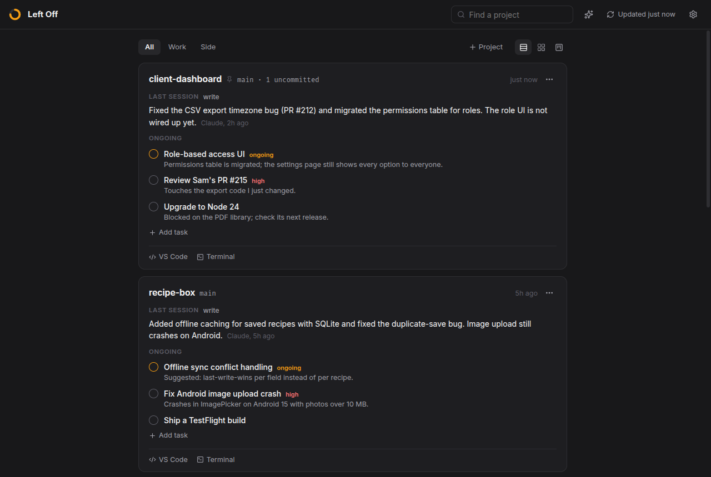
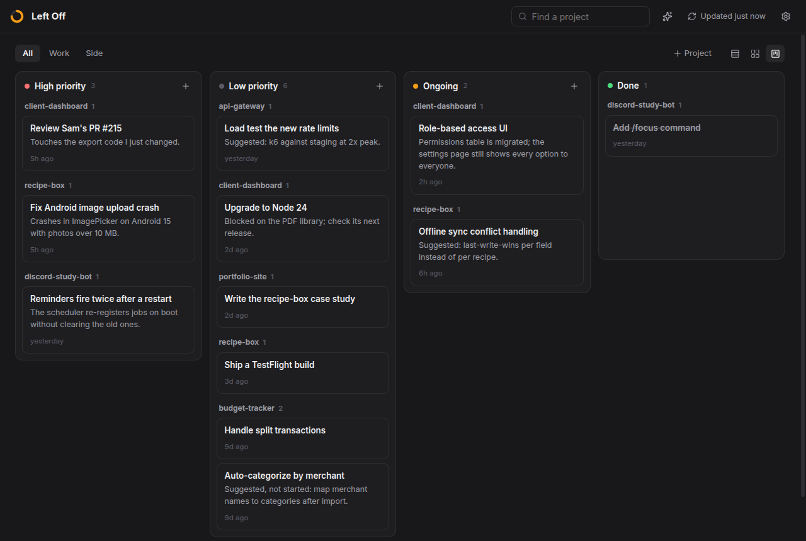

# Left Off

**Pick up any project in seconds, without spending your time or your tokens getting back up to speed.**

Left Off is a desktop app that opens when you log in. For every project, it shows what you did last session and what's still open. You don't keep it up to date yourself: [Claude Code](https://code.claude.com/docs) writes the notes while you work, at a cost of a few hundred tokens per session.



## Who it's for

- **People who lose their place when they switch.** Maybe that's ADHD, maybe it's just too many projects. Either way, you come back and can't remember which bug you were chasing.
- **People without much time.** You get an hour after work or between meetings, and you don't want to spend the first fifteen minutes reading git logs and scrolling old chats.
- **People watching their token budget.** On a Claude plan with usage limits, every "remind me what we were doing" and every "read the repo and catch up" eats into it.

## Why I made this

I have ADHD, and I work on too many things at once: a few apps at my day job plus a pile of side projects. Every time I switched projects I lost my place. I didn't forget what the code does. I forgot what *I* was in the middle of: the bug I was chasing, the fix Claude suggested that I said I'd come back to, the branch I left half-done.

Getting it back cost me twice. It cost time, digging through commits and chats. And it cost tokens, because I had Claude re-read the code or resumed a huge old session just to get the thread back. I'm on a Pro plan, so tokens are something I actually watch.

To-do apps never stuck, because they only work if you remember to update them, and that's the part my brain skips. So Left Off doesn't rely on me remembering. Claude Code is already in the room for most of my work, so it writes things down as it goes, in a sentence or two. When I sit back down, the app tells me where I was, and the next Claude session already knows too.

## What it shows

For each project, two things:

- **Last session:** one to three sentences on what got done.
- **Ongoing:** the tasks still open, including the ones you got sidetracked away from.

That's deliberately all. There are no streaks, charts or notifications. Projects with nothing open that you haven't touched for two weeks fold away under **Quiet**, so the list stays short.

You can switch between three views:

- **List:** one readable column.
- **Grid:** cards across the whole window, good for full screen (F11).
- **Board:** every task as a ticket in High priority, Low priority, Ongoing and Done, grouped by project. You can drag tickets between columns, or right-click one to move it.



## How it stays up to date

Claude Code does the writing, through four pieces that `npm run setup` installs:

1. **The `leftoff` command.** Claude runs `leftoff did "<what got done>"`, `leftoff task "<title>" --note "<where it stands>"` and `leftoff done <task>`. It only writes to Left Off's own data file.
2. **A Claude Code skill.** It tells Claude when to record: at the end of a session, and at the moment you change direction mid-conversation. Say you drop one bug to chase another. The bug you left behind, and any fix Claude suggested that you didn't take up, become tasks right then. They aren't buried 200 messages up.
3. **A session-start hook.** Every new Claude session in a project starts out knowing where you left off there.
4. **A safety net.** Every 8 hours, the app finds Claude sessions that ended without being recorded. It has Claude Haiku summarize each one through your `claude` CLI, at roughly 6k tokens per session. You can turn this off in Settings.

You can also add, edit, drag and tick off tasks yourself, or write a session note by hand. Without Claude Code, Left Off still works as a plain task list next to each project's git status. It just won't fill itself in.

## Light on time and tokens

**Time.** There's nothing to maintain and nothing to set up per project. At login you glance at two things per project, and each card has buttons to jump straight back in. **VS Code** or **Terminal** opens the folder, and **Resume Claude** reopens the last Claude session when you want its full history.

**Tokens.** Here's everything Left Off adds to Claude's context, measured on my own projects:

| What | Tokens | When |
| --- | --- | --- |
| The project's brief, from the session-start hook | ~300–500 | once per new session |
| The skill's description | ~200 | always (that's how Claude Code skills work) |
| The skill's instructions | ~1,500 | only when Claude records something |
| `leftoff did` / `leftoff task` | ~100–200 per command | end of a session, or when you change direction |
| The safety net, on Haiku | ~6,000 per missed session | at most every 8 hours, only for sessions Claude didn't record. You can turn it off. |

Everything else runs locally and costs nothing: scanning your folders, git status, the board.

Where it saves tokens is the start of each session. The brief is already in context, so you don't need "catch me up" prompts, and Claude doesn't have to explore the repo again. You also don't have to resume a long session just to get its thread back, which loads its whole history into context again. And unlike a progress file kept in the repo, there's nothing for Claude to read back and rewrite: the brief is already trimmed down to the last session and the open tasks.

## Also in there

- **Projects without a folder.** Some work starts in a Claude session before there's a repo. That can still be a project: use **+ Project**, or ask Claude to run `leftoff project "<name>"`. Once the repo is cloned, `leftoff bind <folder>` moves everything onto it.
- **Servers.** Save a server once (a name, `user@host` and which SSH key to use), and every Claude session is told about it. "Check the nginx logs on prod-box" just works, through `leftoff ssh prod-box`. You don't paste IPs or key paths into chats.
- **Passwords.** These go into your system keyring (KWallet or GNOME Keyring, via `secret-tool`), and Left Off's files store only their names. Claude can use a password with `leftoff secret run DB_PASS=prod-db -- <command>`, so the value isn't printed into the conversation.
- **An assistant** (Ctrl+K). It's a chat that can rearrange your list for you, e.g. "move the Android crash to high priority and mark the export bug done". It runs on the Claude Agent SDK with your Claude Code login, and its only tools are Left Off's own.

## Install

You'll need:

- **Linux.** I use Fedora with KDE Plasma. Other desktops that follow the XDG autostart spec should work. macOS and Windows aren't supported yet.
- **Node.js 22+ and git.**
- **Claude Code**, installed and logged in, for the recording.
- **`secret-tool`** (from libsecret), for passwords.

```bash
git clone https://github.com/Geanyl17/leftoff.git
cd leftoff
npm install
npm run setup   # builds the app and connects it to Claude Code
npm start
```

`npm run setup` makes three changes outside the repo:

- It links the `leftoff` command into `~/.local/bin`.
- It links the skill into `~/.claude/skills/leftoff`.
- It adds the session-start hook to `~/.claude/settings.json`, saving `settings.json.leftoff-backup` first.

You can do the same later from Settings → Claude Code → Connect. Setup doesn't change your permissions. If you don't want Claude to ask before each `leftoff` command, add `"Bash(leftoff *)"` to `permissions.allow` yourself, or answer "don't ask again" the first time.

On first start, Left Off adds itself to your app launcher and to autostart; autostart can be turned off in Settings. It looks for your project folders in the usual places (`~/code`, `~/projects`, `~/dev` and so on), and you can change them in Settings.

To look around before pointing it at your real work, run `npm run demo`. It opens the app on a set of made-up projects.

If `npm start` says Electron failed to install, run `node node_modules/electron/install.js`. That happens when npm is set to skip install scripts.

## Privacy

Everything stays on your machine, in `~/.config/leftoff`. Left Off makes no network requests of its own. Only two features talk to Claude, and both go through your own Claude Code login, so they count toward your plan's usage:

- **The 8-hour safety net.** It sends a condensed transcript of each unrecorded session to Claude Haiku.
- **The assistant chat**, when you use it.

Left Off reads your Claude Code transcripts from `~/.claude/projects`. These are local files, so switching Claude accounts doesn't lose any history.

## Status

This is early. I built it for myself and use it every day, so expect rough edges. Issues and pull requests are welcome, especially for macOS and Windows support.

## Development

```bash
npm run dev         # hot-reloading dev build
npm run typecheck
npm run build       # then quit Left Off from the tray icon and reopen it
```

- **Throwaway data:** set `XDG_CONFIG_HOME=<dir>`. The app and the CLI both honor it.
- **Running from VS Code or Claude Code terminals:** they set `ELECTRON_RUN_AS_NODE`, so start Electron with `env -u ELECTRON_RUN_AS_NODE …`.
- **Debug hooks:**
  - `LEFTOFF_DUMP=1` prints a scan.
  - `LEFTOFF_CHAT="…"` runs one assistant turn headlessly.
  - `LEFTOFF_SCREENSHOT=out.png` saves the window and exits.

```
src/main/       the app: scanner.ts (git), claude.ts (session transcripts), threadStore.ts (data file),
                vault.ts (keyring + ssh), assistant.ts, index.ts
src/cli/        the `leftoff` command, the session-start hook, autolog.ts (the 8-hour safety net)
src/shared/     types and the task/session rules shared by the app and the CLI
src/renderer/   the window (React)
claude-skill/   the Claude Code skill
```

## License

MIT. See [LICENSE](LICENSE).

Left Off is an independent project and isn't affiliated with or endorsed by Anthropic.
